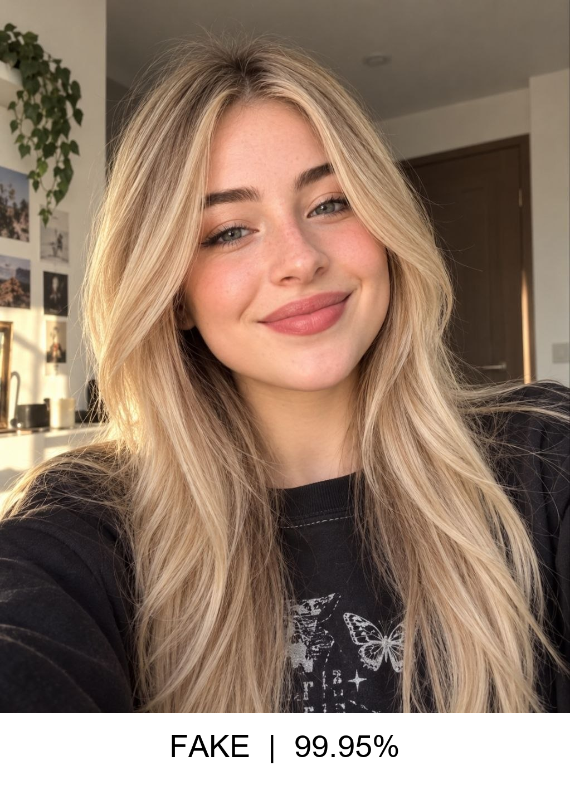

# Deepfake Image Classification System

A Streamlit app that classifies face images as real or fake. It detects and crops the face with OpenCV first, then classifies only that crop with a ResNet50 model.



## Overview

The project focuses on the face, as the name Deepfake suggests. Instead of sending the whole image to the classifier, OpenCV detects the face and crops it, and only the crop reaches the model. This reduces inference time and computational cost, and lets the model focus on the most relevant region.

OpenCV also acts as a filter on the input:

- If a face is detected, the cropped face is passed to the classification model.
- If no face is detected, the image is rejected and never reaches the classification model.

This avoids wasting computation on images that don't contain a face. Every prediction is logged to a local SQLite database and shown in a history panel in the sidebar.

| Class | Label |
|-------|-------|
| 0 | Fake |
| 1 | Real |

## Features

- Face detection and cropping with OpenCV's YuNet detector, with 25% padding around the largest detected face
- Images with no detectable face are rejected before classification
- ResNet50 transfer learning classifier, 224×224 input
- Can also catch some images from newer AI generators such as ChatGPT and Gemini, but not all of them, detection for these is not 100%, roughly 30 to 40%
- Prediction shown with confidence, plus the full Fake / Real probability split
- Every prediction logged to SQLite (file name, date, prediction, confidence)
- Running prediction history displayed in the sidebar

## How It Works

1. On startup, the ResNet50 model and the YuNet face detector are loaded once and cached.
2. The user uploads a JPG or PNG image and clicks **Predict**.
3. YuNet detects faces in the image. If more than one is found, the largest one is used, and the crop is padded by 25% on each side.
4. If no face is found, the app shows a "No face detected" warning and stops.
5. Otherwise the crop is resized to 224×224, normalized, and passed to ResNet50. A softmax gives the Fake and Real probabilities.
6. The predicted class and confidence are shown, and the result is saved to `DataBase.db`.
7. The sidebar reads the full history from the database and shows it as a table.

## Model Evolution

**First version: custom CNN.** The initial version used a custom CNN with four convolutional blocks, built and trained from scratch on a single dataset ([Deepfake and Real Images](https://www.kaggle.com/datasets/manjilkarki/deepfake-and-real-images)). Performance was reasonable, which is expected for a from-scratch model trained on one dataset.

**Current version: ResNet50 transfer learning.** ResNet50 was chosen because pretrained models can reuse visual features learned from large-scale datasets such as ImageNet.

The big improvement did not come from the architecture alone. A custom dataset was also built specifically for this project by combining several deepfake and real-face datasets.

## Dataset

### Sources

The custom dataset combines four sources:

- [HardFake vs Real Faces](https://www.kaggle.com/datasets/hamzaboulahia/hardfakevsrealfaces)
- [Deepfake Face Classification](https://huggingface.co/datasets/pujanpaudel/deepfake_face_classification)
- [Deepfake-vs-Real-60K](https://huggingface.co/datasets/prithivMLmods/Deepfake-vs-Real-60K)
- [Deepfake and Real Images](https://www.kaggle.com/datasets/manjilkarki/deepfake-and-real-images)

### Preparation

To build a balanced and reliable dataset, images were collected from the four sources above. Exact duplicate images were removed using file hashing, so repeated samples don't appear in the data.

For each source, a balanced number of Real and Fake images was selected. The selected images were shuffled randomly and split into:

- 70% training
- 15% validation
- 15% testing

This keeps the classes balanced and prevents exact duplicates from being included unnecessarily.

### Split per source

| Source | Class | Train | Validation | Test |
|--------|-------|-------|------------|------|
| DF40 | Real | 3,500 | 750 | 750 |
| DF40 | Fake | 3,500 | 750 | 750 |
| Deepfake-vs-Real-60K | Real | 3,500 | 750 | 750 |
| Deepfake-vs-Real-60K | Fake | 3,500 | 750 | 750 |
| Deepfake and Real Images | Real | 3,500 | 750 | 750 |
| Deepfake and Real Images | Fake | 3,500 | 750 | 750 |
| HardFake | Real | 412 | 88 | 89 |
| HardFake | Fake | 412 | 88 | 89 |

## Model Performance

### Final model: ResNet50

- Test loss: 0.0638
- Test accuracy: 98.53%

| Class | Precision | Recall | F1-score | Support |
|-------|-----------|--------|----------|---------|
| Fake | 0.9846 | 0.9859 | 0.9853 | 2,342 |
| Real | 0.9859 | 0.9846 | 0.9852 | 2,339 |
| **Accuracy** | | | **0.9853** | 4,681 |
| Macro avg | 0.9853 | 0.9853 | 0.9853 | 4,681 |
| Weighted avg | 0.9853 | 0.9853 | 0.9853 | 4,681 |

The model performs almost identically on both classes, which shows a good balance between Fake and Real predictions.

### Previous model: custom CNN

- Test loss: 0.2220
- Test accuracy: 91.56%

| Class | Precision | Recall | F1-score | Support |
|-------|-----------|--------|----------|---------|
| Fake | 0.8948 | 0.9434 | 0.9185 | 5,492 |
| Real | 0.9392 | 0.8875 | 0.9126 | 5,413 |
| **Accuracy** | | | **0.9156** | 10,905 |
| Macro avg | 0.9170 | 0.9154 | 0.9155 | 10,905 |
| Weighted avg | 0.9168 | 0.9156 | 0.9156 | 10,905 |

Test accuracy improved from 91.56% to 98.53%, and test loss dropped from 0.2220 to 0.0638. Note that the two models were evaluated on different test sets (the old one on the original single dataset, the new one on the combined dataset), so this comparison is a good indication of progress but not a strict like-for-like benchmark.

### Additional testing

During informal testing, the model also correctly classified some recent images generated by ChatGPT and Gemini, with results ranging from good to very good. This is encouraging, since it suggests the model may handle some newer AI-generated images that were not part of the training data. These were informal checks, not a measured benchmark.

## Getting Started

### Install

```bash
git clone https://github.com/i0nlyaziz/Deepfake-Image-Classification-System.git
cd Deepfake-Image-Classification-System
pip install -r requirements.txt
```

### Model weights

The trained model and the face detector aren't stored in the repo. Create a `weights/` folder in the project root, then download both files from the Releases page and place them inside it:

- [best_real_fake_model.pth](https://github.com/i0nlyaziz/Deepfake-Image-Classification-System/releases/download/v1.0/best_real_fake_model.pth): the trained ResNet50 classifier
- [face_detection_yunet_2026may.onnx](https://github.com/i0nlyaziz/Deepfake-Image-Classification-System/releases/download/v1.0/face_detection_yunet_2026may.onnx): the YuNet face detector

### Run

```bash
streamlit run main.py
```

This opens the app in your browser. Upload an image and click **Predict**.

## Project Structure

```
Deepfake-Image-Classification-System/
├── README.md
├── LICENSE
├── requirements.txt
├── .gitignore
├── main.py                                 # Streamlit app: UI, face detection, prediction
├── database.py                             # SQLite creation, insert, and read functions
├── weights/
│   ├── face_detection_yunet_2026may.onnx   # YuNet face detector (not tracked in git, see above)
│   └── best_real_fake_model.pth            # trained weights (not tracked in git, see above)
└── results/
    └── demo.png                            # sample app screenshot
```

## Database

`DataBase.db` stores one record per prediction:

| Column | Description |
|--------|-------------|
| ID | Record ID |
| File Name | Name of the uploaded image |
| Date | Timestamp of the prediction |
| Prediction | "Fake" or "Real" |
| Confidence | Model confidence (stored as a 0 to 1 value, shown as a percentage in the app) |

Only the file name is stored, not the image itself.

## Tech Stack

PyTorch, torchvision, ResNet50, OpenCV (YuNet), Streamlit, Pandas, Pillow, SQLite

## Limitations

- The system only works on images that contain a detectable face anything else is rejected
- If an image has several faces, only the largest one is classified
- Results are probabilistic, not proof: a prediction is a model's best estimate, and it can be wrong
- The model was trained on specific datasets, so accuracy on images from generators or sources very different from the training data isn't guaranteed
- Low-quality images, or images with heavy filters (such as beauty filters or smoothing), can remove fine face details. When the face details are missing or blurred, the model may classify the image as Fake, because that smooth look resembles an AI-generated style
- Prediction history in `DataBase.db` is stored locally and isn't part of the repo

## License

MIT, see [LICENSE](LICENSE) for details.